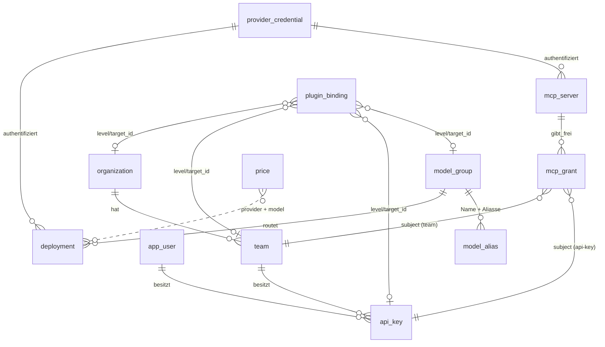

# ai-gw – Datenmodell, Migrationen und Konfiguration (AIGW-9)

Stand: 2026-11-13 · Status: umgesetzt (Entwurf zur Durchsicht)
Grundlage: [00-entscheidungen.md](00-entscheidungen.md) (E4, E7), [01-architektur.md](01-architektur.md) §13–§14

## 1. Überblick

| Schicht | Ort | Inhalt |
|---|---|---|
| Startkonfiguration | `config/*.yaml`, `aigw_core::config` | nur, was vor dem Öffnen der DB nötig ist: Listener, Datenbank, Zähler-Backend, Master-Key, Logging |
| Ressourcen-Modell | `aigw_core::resource` | Rust-Typen = Quelle der Wahrheit für DB, Admin-API (utoipa → OpenAPI → TS) und GitOps-YAML |
| Persistenz | `aigw-store` (`migrations/`, `repo/`) | Schema, CRUD in Transaktionen mit `config_version` + `audit_log`, Verschlüsselung, Key-Erzeugung |
| Snapshot | `aigw_core::snapshot`, `aigw_store::load_snapshot` | unveränderlicher RAM-Stand mit Indizes für den Hot Path |

## 2. Startkonfiguration (YAML, E7)

```yaml
server:
  listen: "127.0.0.1:4000"
store:
  url: "sqlite://aigw.db?mode=rwc"   # oder postgres://benutzer@host/db
  max_connections: 10
counters:
  backend: local                     # local | postgres-sync | redis
  # redis_url: "redis://127.0.0.1:6379/0"
secrets:
  # master_key_file: /run/secrets/aigw-master-key
  master_key_env: AIGW_MASTER_KEY    # Variable mit dem Key, wenn keine Datei angegeben ist
  previous_key_files: []             # nur zum Entschlüsseln während einer Rotation
log:
  level: info                        # Filter wie RUST_LOG
  format: text                       # text | json
```

- Alle Felder optional (Standardwerte), unbekannte Felder sind ein Fehler (`deny_unknown_fields`).
- **Umgebungsvariablen** überschreiben jeden Wert: `AIGW_<ABSCHNITT>__<FELD>` (doppelter Unterstrich
  als Trenner, tiefere Ebenen ebenso), z. B. `AIGW_STORE__URL`, `AIGW_STORE__MAX_CONNECTIONS=20`,
  `AIGW_SECRETS__PREVIOUS_KEY_FILES=/a,/b` (Listen kommagetrennt). Zahlen und Wahrheitswerte werden
  passend zum Feldtyp umgewandelt; Tippfehler in Abschnitt/Feld führen zum Startabbruch mit Nennung
  der Variable. Variablen ohne `__` (`AIGW_CONFIG`, `AIGW_LOG`, `AIGW_TEST_POSTGRES_URL` …) sind
  keine Overrides.
- Hinweis YAML: Werte mit `:` am Ende (z. B. `sqlite::memory:`) in Anführungszeichen setzen.

### 2.1 Wahl des YAML-Parsers

Kriterien: aktiv gepflegt, kein `unsafe`-C (auch kein nach Rust übersetztes libyaml), serde-kompatibel
inkl. `deny_unknown_fields`, Mehrfachdokumente (`---`) für GitOps, Lizenz AGPL-kompatibel.

| Kandidat | Stand (11/2026) | Bewertung |
|---|---|---|
| `serde_yaml` | archiviert (2024) | ausgeschlossen (bereits in `deny.toml` gebannt) |
| `serde_yml` | RUSTSEC-Hinweise, Pflege unklar | ausgeschlossen |
| `serde_norway`, `serde_yaml_ng` | Forks von serde_yaml | basieren auf `unsafe-libyaml` (c2rust-Übersetzung von libyaml, durchgehend `unsafe`) |
| `yaml_serde` (YAML-Organisation) | gepflegt | basiert auf `libyaml-rs` (ebenfalls übersetztes libyaml), eigenes `unsafe` |
| `saphyr` / `yaml-rust2` | gepflegt, reines Rust | nur Parser/DOM, keine serde-Integration |
| **`serde-saphyr` 2.x** | aktiv gepflegt, MIT/Apache-2.0 | **gewählt**: serde direkt auf dem reinen Rust-Parser `granit-parser` (`#![forbid(unsafe_code)]`), panikfrei, gute Fehlermeldungen mit Zeile/Spalte, `from_multiple`/`to_string_multiple`, eingebaute Budgets gegen YAML-Bomben (Anker-Expansion, Tiefe, Größe) |

Abgeschaltet: Default-Features (`comments`), aktiv nur `deserialize` und `serialize`. Risiko: kleineres
Projekt mit wenigen Maintainern – der Parser ist hinter `Config::from_yaml` bzw.
`Manifest::parse_yaml` gekapselt und damit austauschbar.

## 3. Ressourcen-Modell

Jede Ressource = `metadata` (Name, Labels, `createdAt`/`updatedAt`) + `spec`; gelesen zusätzlich `id`
(UUIDv7, zeitlich sortierbar). Verweise auf andere Ressourcen stehen in `spec` **als Name**, in der
Datenbank als ID-Fremdschlüssel; das Repository löst Namen beim Schreiben auf und liefert beim Lesen
wieder Namen. Namen sind je Art global eindeutig (`a-z0-9-._`, max. 128 Zeichen).

| Art (`kind`) | Spezifikation (Auszug) |
|---|---|
| `Organization` | displayName, limits, budget, metadata |
| `Team` | organization, displayName, allowedModels, limits, budget, metadata |
| `User` | oidcIssuer + oidcSubject, email, displayName, roles (Rolle, optional auf Org/Team) |
| `ApiKey` | team?, user?, expiresAt?, allowedModels, limits, budget, metadata; Status (vom Server): prefix, state (`active`/`revoked`), lastUsedAt |
| `ProviderCredential` | provider, data (Feld → `value` bzw. `valueFrom`); gelesen nur provider, Feldnamen, keyId |
| `ModelGroup` | aliases, routing (`weighted`/`least-latency`/`least-busy`/`cost`), fallbacks (modelGroup + Auslöser), limits, settings |
| `Deployment` | modelGroup, provider, endpoint?, providerModel, credential?, weight, priority, capacity (rpm/tpm), enabled, settings |
| `Price` | provider?, model, validFrom, perMillionTokens (input, output, cachedInput, cacheWrite, reasoning, audio-/imageInput, audioOutput), perRequest?, perImage? |
| `PluginBinding` | scope (level `global`/`organization`/`team`/`api-key`/`model-group` + target), plugin, order, enabled, config (JSON) |
| `McpServer` | url, transport (`streamable-http`/`sse`/`stdio`), credential?, enabled, settings |
| `McpGrant` | server, subject (level `team`/`api-key` + target), tools (leer = alle) |

Bausteine: `LimitSpec` (metric `requests`/`tokens`/`input-tokens`/`output-tokens`/`concurrency`,
limit, window `second`/`minute`/`hour`/`day`, optional modelGroup), `Budget` (amount, period
`day`/`week`/`month`/`total`, warnAtPercent, hardLimit).

**Geldbeträge** (`Amount`): Festkomma in Nano-Einheiten (10⁻⁹) der Abrechnungswährung als `i64` –
exakt summierbar, nach außen als Dezimaltext (`"2.50"`, in YAML auch als Zahl erlaubt). Preise gelten
je 1 Mio. Tokens.

**Geheimnisse**: `SecretString` gibt in `Debug`/`Serialize` nur `<redacted>` aus und lehnt
`<redacted>` als Eingabe ab (Schutz vor GET→PUT-Rundreisen). In GitOps-YAML sind nur Verweise erlaubt:
`valueFrom: {env: NAME}` oder `valueFrom: {file: /pfad}`; Klartext (`value`) nur über die Admin-API.

### 3.1 GitOps-YAML (`apiVersion: aigw/v1alpha1`)

```yaml
apiVersion: aigw/v1alpha1
kind: ProviderCredential
metadata:
  name: openai-prod
spec:
  provider: openai
  data:
    apiKey:
      valueFrom:
        env: OPENAI_API_KEY
---
apiVersion: aigw/v1alpha1
kind: ModelGroup
metadata:
  name: gpt-4o
  labels: {tier: premium}
spec:
  aliases: [gpt-4o-latest]
  routing: least-latency
  fallbacks:
    - modelGroup: claude-sonnet
      on: [rate-limit, unavailable]
---
apiVersion: aigw/v1alpha1
kind: Deployment
metadata:
  name: gpt-4o-openai
spec:
  modelGroup: gpt-4o
  provider: openai
  providerModel: gpt-4o-2024-08-06
  credential: openai-prod
  weight: 3
  capacity: {rpm: 500, tpm: 300000}
---
apiVersion: aigw/v1alpha1
kind: Price
metadata:
  name: gpt-4o-2024-08
spec:
  provider: openai
  model: gpt-4o-2024-08-06
  validFrom: 2024-08-06T00:00:00Z
  perMillionTokens: {input: "2.50", cachedInput: "1.25", output: "10"}
---
apiVersion: aigw/v1alpha1
kind: Team
metadata:
  name: platform
spec:
  organization: acme
  allowedModels: [gpt-4o]
  limits:
    - {metric: tokens, limit: 100000, window: minute}
  budget: {amount: "500", period: month, warnAtPercent: [80, 100]}
---
apiVersion: aigw/v1alpha1
kind: PluginBinding
metadata:
  name: pii-platform
spec:
  scope: {level: team, target: platform}
  plugin: pii
  order: 10
  config: {mode: mask}
```

`Manifest::parse_yaml` liest Mehrfachdokumente und prüft `apiVersion`, `kind`, unbekannte Felder,
Namen und die Geheimnisregel; `Manifest::to_yaml` schreibt sie (Rundreise getestet). Die Anwendung
(`aigw config apply`, Diff/`--prune`) ist nicht Teil von AIGW-9. `ResourceKind::ALL` liefert die
Abhängigkeitsreihenfolge für Import/Export.

## 4. Datenbankschema

**Ein** Migrationssatz (`crates/aigw-store/migrations/`) für SQLite und Postgres. Portabilität durch
Beschränkung auf `TEXT` und `BIGINT`:

| Inhalt | Darstellung |
|---|---|
| IDs | UUIDv7 als `TEXT` |
| Zeitpunkte | Unix-Millisekunden (UTC) als `BIGINT` |
| Geld | Nano-Einheiten als `BIGINT` (bzw. Dezimaltext im JSON der Preise) |
| Wahrheitswerte | `BIGINT` 0/1 |
| Listen/Objekte (Limits, Budget, Settings, Labels …) | JSON als `TEXT` |
| Chiffrat, Nonce | Hex als `TEXT` |

Zugriff über den `Any`-Treiber von sqlx mit `$n`-Platzhaltern (beide Datenbanken verstehen sie) –
damit gibt es genau einen Code-Pfad. Migrationen sind eingebettet (`aigw_store::migrator()`), keine
Compile-Zeit-Makros, kein DB-Zugriff beim Bauen. Für spätere Postgres-Spezialitäten (LISTEN/NOTIFY,
pgvector) wird zusätzlich ein typisierter `PgPool`/`PgListener` geöffnet.

### 4.1 ER-Übersicht



### 4.2 Tabellen

| Tabelle | Zweck / Besonderheiten |
|---|---|
| `config_version` | genau eine Zeile; jede Admin-Transaktion erhöht `version` als **erste** Anweisung (bei SQLite sofort Schreibsperre, kein Lock-Upgrade) |
| `audit_log` | wer, was (`create`/`update`/`delete`/`rotate`), Art, ID, Name, Version, vorher/nachher als JSON (ohne Geheimnisse) |
| `organization`, `team`, `app_user` | Mandanten; `user` ist in Postgres reserviert, daher `app_user`; OIDC (Issuer, Subjekt) eindeutig |
| `api_key` | `prefix` (eindeutig, sichtbar), `key_hash` (SHA-256 hex, eindeutig), `state`, `team_id`/`user_id` (FK), Ablauf, Limits, Budget, Modelle, Metadaten, `last_used_at` |
| `provider_credential` | `provider`, `fields` (nur Namen), `key_id`, `nonce`, `ciphertext` |
| `model_group`, `model_alias` | `model_alias` hält Name **und** Aliasse aller Gruppen in einem eindeutigen Namensraum |
| `deployment` | FK auf Modellgruppe und Zugangsdaten; `weight`, `priority`, `rpm`, `tpm`, `enabled` |
| `price` | eindeutig je (`provider`, `model`, `valid_from`); `provider = ''` = alle Anbieter; Token-Preise als JSON |
| `plugin_binding` | polymorpher Verweis (`level`, `target_id`) ohne FK; Löschen des Ziels löscht Bindungen in derselben Transaktion |
| `mcp_server`, `mcp_grant` | Freigabe je Team/Key (polymorph wie oben), `tools` als JSON-Liste |
| `counter_state` | nur `postgres-sync`: (Schlüssel, Fensterbeginn, Instanz) → Wert |
| `budget_usage` | (Ebene, Ziel, Zeitraum, Beginn) → Betrag (Nano) |
| `request_log` | ein Eintrag je Anfrage (ID = `x-aigw-request-id`), Tokens, Kosten, Latenz/TTFT, Cache, optional maskierter Payload; Indizes nach Zeit, Key, Team |
| `usage_rollup` | Minuten-Rollups je Key/Team/Org/Modellgruppe/Deployment (`''` statt NULL, da Teil des PK) |

Löschen: Fremdschlüssel verhindern das Löschen verwendeter Ressourcen (Fehler `Conflict`), z. B.
eine Modellgruppe mit Deployments; Aliasse und Freigaben eines MCP-Servers fallen per Kaskade weg.

## 5. Repository

- `Store::create/update/get/get_by_id/list::<Spec>()` für alle Arten außer Keys und Zugangsdaten,
  `Store::delete(actor, kind, name)` für alle Arten.
- Jede Änderung: **eine** Transaktion → `config_version + 1` → Änderung → `audit_log` → Commit.
  Fehlgeschlagene Änderungen (Konflikt, ungültiger Verweis) hinterlassen weder Version noch Audit.
- **API-Keys**: `create_api_key` erzeugt `sk-aigw-<12 Zeichen Präfix>-<43 Zeichen Base62 aus 32 Byte
  Zufall>` (aws-lc-rs `SystemRandom`), speichert nur Präfix und SHA-256 und gibt den Klartext einmalig
  zurück (`CreatedApiKey`). Dazu `get_api_key`, `list_api_keys`, `update_api_key`, `revoke_api_key`,
  `touch_api_keys` (letzte Nutzung, ohne Versionserhöhung).
- **Zugangsdaten**: AES-256-GCM über aws-lc-rs (gleicher Provider wie rustls, kein zusätzliches
  Krypto-Crate). Klartext-Felder als JSON verschlüsselt, zufällige 96-Bit-Nonce je Schreibvorgang,
  AAD = Ressourcen-ID (Chiffrat lässt sich nicht in andere Zeilen kopieren). Master-Key: 32 Byte hex
  aus Datei oder Umgebungsvariable, nie in der DB. `key_id` = erste 8 Byte von
  SHA-256(`"aigw-master-key-id"` ‖ Key). **Rotation**: neuen Key als `master_key_file`, alten unter
  `previous_key_files`, dann `rotate_credentials` (verschlüsselt alle Datensätze mit fremder `key_id`
  neu, je Datensatz ein Audit-Eintrag `rotate`).

## 6. Snapshot

`load_snapshot(&Store, &Keyring) -> Snapshot` liest alle Ressourcen und baut:

- `keys`: SHA-256 → `KeyCtx` (Key, Team, Organisation; nur `active`, Ablauf prüft der Hot Path),
- `model_groups`: Name **und** Alias → `ModelGroupCtx` (aktive Deployments nach Priorität, mit
  entschlüsselten Zugangsdaten),
- Preise je (Anbieter, Modell) nach `validFrom` (`Snapshot::price_at`), Plugin-Bindungen nach Ebene
  und Reihenfolge, MCP-Server und -Freigaben, Organisationen/Teams nach ID.

Konsistenz: Version vor und nach dem Lesen vergleichen, bei Änderung neu laden (optimistisch). Das
Verteilen per `ArcSwap` und LISTEN/NOTIFY ist AIGW-10.

## 7. Tests

- `aigw-core`: Konfiguration (Standardwerte, unbekannte Felder, ENV-Overrides inkl. Fehlerfälle,
  Beispiel-Configs), Manifeste (Mehrfachdokument, Rundreise, Geheimnisregel, Versionen), Beträge.
- `aigw-store`: Krypto (Rundreise, AAD-Bindung, Manipulation, Rotation), Key-Format/Base62/SHA-256,
  Integrationstest `tests/store.rs` (Migrationen, CRUD aller Arten, Konflikte, Rollback, Audit +
  Version, Snapshot, Rotation, Löschregeln) gegen SQLite in-memory, SQLite-Datei und – mit
  `AIGW_TEST_POSTGRES_URL` – Postgres (je Lauf eigene Wegwerf-Datenbank).
- `scripts/check.sh`: `AIGW_TEST_POSTGRES=docker` startet dafür einen `postgres:17`-Container.
