# 04 – UX-Konzept und Design-System der Admin-UI

> Status: **Entwurf zur Abnahme** (AIGW-48) · Stand: 2026-11-13 · Grundlage: cloud-project-Portal, Variante C
> „Technisch“ (CLOU-106), Vorbild Cloudflare-Dashboard · Umsetzung: `ui/` (Svelte 5, Vite, Bits UI, Tailwind 4)
>
> Offene Designfragen (Akzentfarbe, Diagramm-Bibliothek, Schrift, Dichte) sind in §9 gesammelt und **nicht**
> entschieden; die Musterseiten zeigen jeweils den Vorschlag, Alternativen sind umschaltbar.

## 1. Ziel und Prinzipien

Die Admin-UI soll sich wie ein hochwertiges SaaS-Produkt anfühlen (Cloudflare, Vercel, Portkey), nicht wie ein
technisches Konfigurationsformular. Inhaltlich orientiert sie sich an LiteLLM Admin UI, Kong Konnect AI Gateway,
Azure API Management/AI Foundry, Portkey und Cloudflare AI Gateway.

1. **Übersicht zuerst.** Jede Bereichsseite beginnt mit dem Zustand (Kennzahlen, Status), dann folgt die Liste,
   dann das Detail. Zahlen immer mit Einheit und Vergleich (Vorperiode).
2. **Ruhig und dicht.** Neutrale Flächen, eine Akzentfarbe nur für Aktion/Auswahl, Statusfarben nur für Status.
   14-px-Grundschrift, 4-px-Raster, kleine Radien (Variante C). Tabellen sind das Hauptwerkzeug.
3. **Detail ohne Kontextverlust.** Details als Sheet (Seitenpanel) oder Master/Detail statt Seitenwechsel; Dialoge
   nur für Bestätigungen und kurze Formulare.
4. **Sicher by Design.** Secrets werden genau einmal im Klartext gezeigt; destruktive Aktionen brauchen Bestätigung
   mit Klartext-Folgen; Mock-Daten sind immer sichtbar gekennzeichnet.
5. **Barrierefrei.** Bits UI für alle komplexen Widgets (Fokusfalle, Tastatur, ARIA); Status nie nur über Farbe
   (immer Text/Icon); Fokus-Ring über Token; `prefers-reduced-motion` schaltet Bewegung ab.
6. **Strikte CSP ohne Ausnahme.** Keine Inline-Skripte/-Styles, keine externen Fonts/CDNs; Geometrie über
   SVG-Attribute oder CSSOM (siehe §7).
7. **Alles per Tastatur.** Befehlspalette (⌘K/Strg+K) für Navigation und häufige Aktionen.

## 2. Design-Tokens

Quelle: `ui/src/styles/tokens.css` (Tailwind-4-`@theme`). Die Standardpalette von Tailwind ist abgeschaltet
(`--color-*: initial`), es gibt nur semantische Tokens. Aus Variante C übernommen: neutrale Flächen, Radien,
Monospace für Zahlen in Tabellen, dunkle Seitenleiste auch im Hellmodus; für ai-gw eigenständig benannt
(Utilities `bg-surface`, `text-fg-muted`, `border-line`, `bg-accent` …).

### 2.1 Farben (hell / dunkel)

| Token | Hell | Dunkel | Verwendung |
|---|---|---|---|
| `bg` | `#f1f3f5` | `#0a0c0f` | Seitenhintergrund |
| `surface` / `surface-2` / `surface-hover` | `#ffffff` / `#edf0f3` / `#e5e9ed` | `#111418` / `#171b20` / `#1d2228` | Karten, Tabellenkopf, Hover |
| `line` / `line-strong` | `#d6dbe1` / `#7b8592` | `#242a32` / `#66717e` | Ränder, Eingabe-Hover |
| `fg` / `fg-muted` / `fg-subtle` | `#101418` / `#505965` / `#6b7480` | `#e1e6eb` / `#98a2ae` / `#7f8995` | Text |
| `accent` (+ `-hover`, `on-accent`, `accent-text`, `accent-soft`, `accent-soft-fg`, `focus`) | `#5b45d6` | `#9d8cff` | Primäraktion, Auswahl, Fokus |
| `success` / `warning` / `danger` / `info` / `neutral` (je `-bg`, `-fg`) | z. B. `#e5f4ea`/`#17652f` | `#143120`/`#86dba0` | nur Status |
| `sidebar`, `sidebar-line` | `#0c0e11` | `#0c0e11` | Seitenleiste (immer dunkel) |
| `code`, `code-fg`, `code-*` | `#0e1115` | `#0b0c0e` | Code-/Key-Anzeige (immer dunkel) |
| `chart-1` … `chart-6` | `#2a78d6` `#eb6834` `#1baf7a` `#eda100` `#e87ba4` `#6250d6` | `#3987e5` `#d95926` `#199e70` `#c98500` `#d55181` `#9085e9` | Diagramm-Serien, feste Reihenfolge |

Hell/Dunkel: helle Werte im `@theme`, dunkle als Block für `<html data-theme="dark">` **und** für Teilbäume mit
`.scheme-dark` (Seitenleiste, Code). Bewusst ohne `light-dark()`, weil Lightning CSS es für ältere Browser durch am
`<html>` aufgelöste Variablen ersetzt – dunkle Teilbäume im Hellmodus funktionierten damit nicht (im Browser geprüft).

Diagrammfarben: kategoriale Reihenfolge ist fest (nie zyklisch, nie nach Rang), Statusfarben sind keine Serien;
eine Serie = eine Achse, Kreuz + Tooltip beim Überfahren, Bildschirmleser-Zusammenfassung (min/max/zuletzt).

### 2.2 Typografie, Abstände, Radien, Schatten, Bewegung

| Kategorie | Werte |
|---|---|
| Schrift | Systemschriften (`system-ui …`), Monospace `ui-monospace …`; keine Webfonts (CSP, Größe) |
| Größen | `2xs` 11 · `xs` 12 · `sm` 13 · **`base` 14** · `md` 16 · `lg` 18 · `xl` 22 · `2xl` 28 px |
| Zahlen | `.num` = Monospace + Tabellenziffern (Tabellen, IDs); KPI-Kacheln Sans mit Tabellenziffern |
| Etiketten | `.label-caps` 11 px, Versalien, Laufweite 0,08 em (Gruppenüberschriften) |
| Abstände | Tailwind-Raster 4 px; Seitenränder 16/24/32 px; Kartenabstand 16 px |
| Radien | `xs` 2 · `sm` 3 · `md` 4 · `lg` 6 · `xl` 8 px (Dialoge) |
| Schatten | `card` (Kontur + 1 px), `pop` (Menüs/Popover), `dialog` (Dialoge/Sheets) |
| Bewegung | 140–240 ms, `ease-out`; Pop/Fade/Dialog/Sheet/Toast; aus bei `prefers-reduced-motion` |
| Layout | Seitenleiste 240 px (ab `lg` = 1024 px), Topbar 56 px, Inhalt max. 1440 px |

### 2.3 Farbschema-Umschaltung

`System | Hell | Dunkel` im Nutzer-Menü, in den Einstellungen und in der Befehlspalette (`prefs.svelte.ts`,
gespeichert in `localStorage`). Am `<html>` steht immer das wirksame Schema (`data-theme`), damit ändert sich bei
„System“ die Darstellung live mit dem Betriebssystem. Vorbelegung per URL: `?theme=dark&accent=petrol&mock=0`.

## 3. App-Shell und Navigation

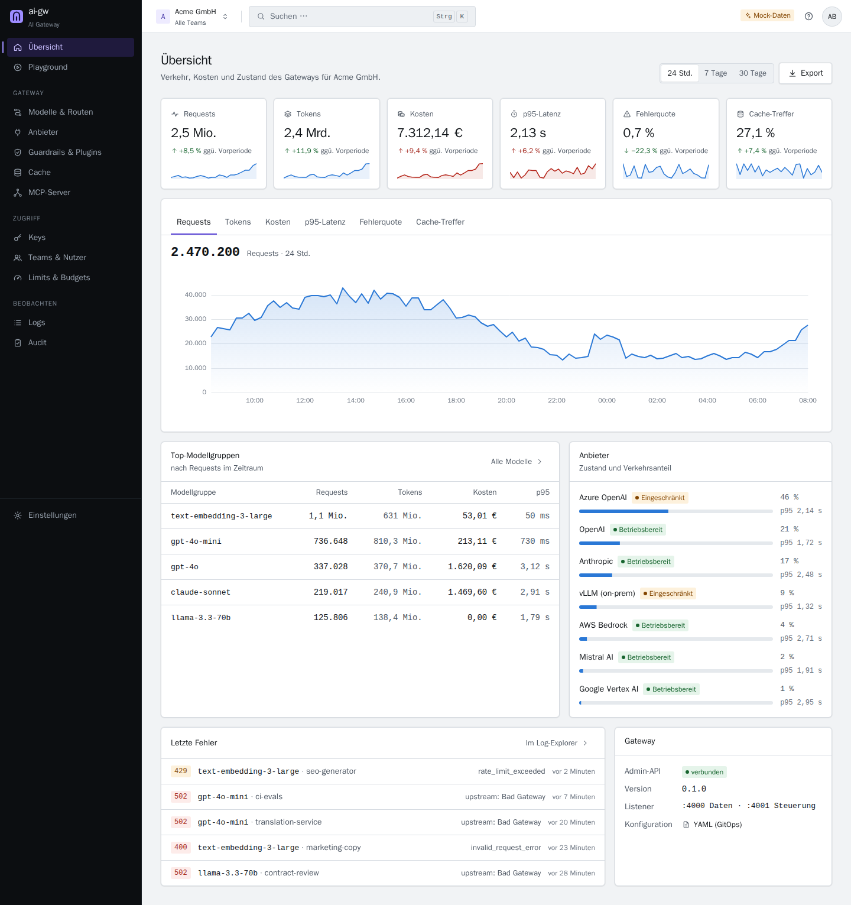

- **Seitenleiste** (dunkel, ab 1024 px fest, darunter als Sheet hinter dem Menü-Button) mit Gruppen:

| Gruppe | Einträge |
|---|---|
| – | Übersicht, Playground |
| Gateway | Modelle & Routen, Anbieter, Guardrails & Plugins, Cache, MCP-Server |
| Zugriff | Keys, Teams & Nutzer, Limits & Budgets |
| Beobachten | Logs, Audit |
| (unten) | Einstellungen |

- **Topbar:** Organisation/Team-Umschalter (Dropdown mit Radiogruppen; Team filtert Listen), Suche als Auslöser der
  **Befehlspalette** (⌘K/Strg+K: Seiten, Aktionen, Modellgruppen, Keys), Hinweis „Mock-Daten“ (klickbar zum
  Ausschalten), Hilfe, **Nutzer-Menü** (Identität/Rolle, Farbschema, Mock-Daten, Einstellungen, API-Doku, Abmelden).
- **Routing:** echte Pfade unter `/admin/…` (History-API; aigw-admin liefert für Pfade ohne Endung `index.html`),
  Seiten per dynamic import, Fokus nach Seitenwechsel auf die `h1`, „Zum Inhalt springen“-Link.
- **Responsiv:** < 640 px eine Spalte, Tabellen blenden Nebenspalten aus (`from: 'md' | 'lg' | 'xl'`), Filter
  umbrechen; Dialoge maximal Bildschirmhöhe mit scrollendem Inhalt.

| Schmal: Navigation | Schmal: Übersicht (dunkel) | Befehlspalette |
|---|---|---|
| 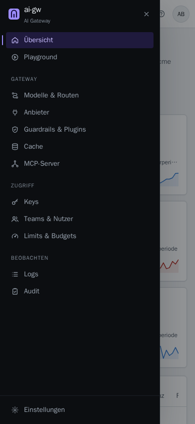 | 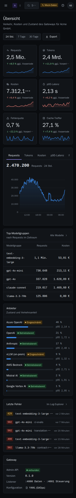 | 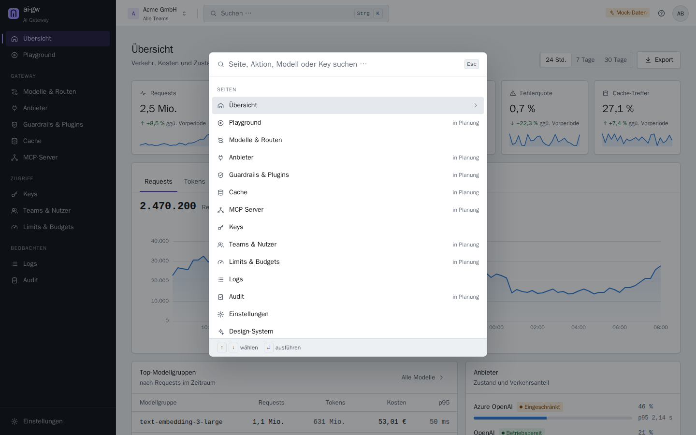 |

## 4. Komponenten

Alle interaktiven Bausteine basieren auf **Bits UI 2** (headless) und werden über Klassen-Rezepte
(`ui/src/lib/ui/styles.ts`) gestylt; Übersicht unter `/admin/design`.

| Komponente | Datei | Basis | Hinweise |
|---|---|---|---|
| Button (primary, secondary, ghost, danger, link; sm/md/icon; loading; als Link) | `Button.svelte` | `<button>`/`<a>` | Rezept `btn()` auch für Bits-Trigger |
| Input (Icon, Suffix), Formularmuster `Field` | `Input.svelte`, `Field.svelte` | nativ | Label oben, Hilfe/Fehler per `aria-describedby`, Fehler ersetzt Hilfe, Validierung beim Absenden, Fokus aufs erste fehlerhafte Feld |
| Select | `Select.svelte` | Bits `Select` | Typeahead, Hinweiszeile je Option |
| Checkbox, RadioGroup (Karten), Switch | direkt Bits | Bits | Karten-Radio für Entscheidungen mit Erklärung |
| Dialog | `Dialog.svelte` | Bits `Dialog` | Kopf/Inhalt/Fußzeile, `dismissible=false` für Pflichtbestätigung |
| Sheet | `Sheet.svelte` | Bits `Dialog` | rechts (Details) / links (mobile Navigation) |
| Dropdown-Menü | Bits `DropdownMenu` + `menuItem` | Bits | Radio-/Checkbox-Einträge, Gefahrenaktion rot und zuletzt |
| Tabs, Segment-Umschalter | Bits `Tabs`, `ToggleGroup` + Rezepte | Bits | Unterstrich-Tabs, Segment für Zeitraum |
| Tooltip | `Tooltip.svelte` | Bits `Tooltip` | nur ergänzend, Trigger bleibt eigenes Element |
| Badge / Status | `Badge.svelte` | – | Töne neutral/accent/success/warning/danger/info/outline, Punkt, Monospace |
| Tabelle | `DataTable.svelte` | Bits `Pagination` | Suche, Filter-Slot, Sortierung (`aria-sort`), Pagination + Zeilen/Seite, Kein-Treffer-Zustand mit „Filter zurücksetzen“, klickbare Zeilen |
| Karte, KPI-Kachel, Sparkline, Meter | `Card`, `KpiTile`, `Sparkline`, `Meter` | SVG | Veränderung als Pfeil + Text, Bewertung „besser = hoch/niedrig“; Budget-Meter ab 80 % gelb, ab 95 % rot |
| Zeitreihen-Diagramm | `TimeSeriesChart.svelte` | uPlot | Token-Farben, Kreuz + Tooltip, Neuzeichnen bei Schema/Akzent |
| Leerer Zustand | `EmptyState.svelte` | – | Icon, Titel, Erklärung, nächste Aktion; auch „API noch nicht verfügbar“ |
| Toast | `Toaster.svelte`, `toast.svelte.ts` | aria-live | pausiert bei Hover/Fokus, Fehler als `role=alert` |
| Code-/JSON-Anzeige | `CodeBlock.svelte` | – | immer dunkel, Hervorhebung ohne `{@html}`, Kopieren |
| Einmalige Key-Anzeige | `SecretReveal.svelte` | Bits `Checkbox` | Warnhinweis, Kopieren, Verbergen, „gespeichert“-Bestätigung schaltet „Fertig“ frei |
| Kopieren | `CopyButton.svelte` | Clipboard-API | sichtbare + vorgelesene Bestätigung |
| Seitenkopf | `PageHeader.svelte` | – | Titel, Beschreibung, Badge, Aktionen |
| Shell | `lib/shell/*` | Bits | Seitenleiste, Topbar, Kontext-Umschalter, Nutzer-Menü, Befehlspalette |

Befehlspalette: eigenes APG-Muster (Combobox + Listbox mit `aria-activedescendant`) im Bits-Dialog, weil
**Bits UI `Command` statische `style`-Attribute rendert** (CSP `style-src-attr`) – Befund aus dem cloud-project-Spike,
für bits-ui 2.20.6 im Quelltext erneut bestätigt (einzige Bits-Komponente mit statischen Styles).

## 5. Musterseiten (klickbar, Mock-Daten)

Mock-Modus: Umschalter in Topbar-Badge, Nutzer-Menü, Einstellungen und Befehlspalette (Standard **an**, solange die
Admin-API nur `/version` kennt; `MOCK_DEFAULT` in `prefs.svelte.ts`). Die Daten sind deterministisch (fester Seed,
`lib/mock/data.ts`); die Datenschicht `lib/data.svelte.ts` liefert ohne Mock `unavailable` und die Seiten zeigen
einen Leerzustand statt erfundener Zahlen. Die Gateway-Version kommt immer von der echten API.

### 5.1 Übersicht

KPI-Kacheln (Requests, Tokens, Kosten, p95-Latenz, Fehlerquote, Cache-Treffer; Veränderung zur Vorperiode und
Mini-Verlauf), Zeitraum 24 Std./7 Tage/30 Tage, Zeitreihe je Kennzahl (Tabs), Top-Modellgruppen, Anbieter mit
Zustand und Verkehrsanteil, letzte Fehler (→ Log-Explorer), Gateway-Info (Version live).

| Hell | Dunkel |
|---|---|
|  | 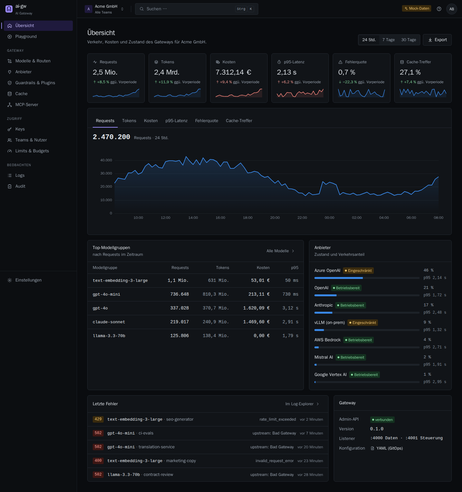 |

### 5.2 Keys

Kennzahlen (aktiv, laufen ab, Budget ≥ 80 %, gesperrt), Tabelle mit Name + Präfix…letzte 4, Team, Modellen, Budget
(Meter), Limits, letzter Nutzung, Status; Filter Status/Team, Suche, Sortierung, Pagination; Zeilenmenü (Bearbeiten,
Rotieren, ID kopieren, Sperren mit Bestätigungsdialog). **„Key erstellen“**: Formular (Name, Team, Ablauf,
Modellzugriff alle/ausgewählte, Budget, RPM/TPM) → **einmalige Klartext-Anzeige** mit Schnellstart-Snippet.

| Liste | Erstellen (dunkel) | Einmalige Anzeige |
|---|---|---|
| 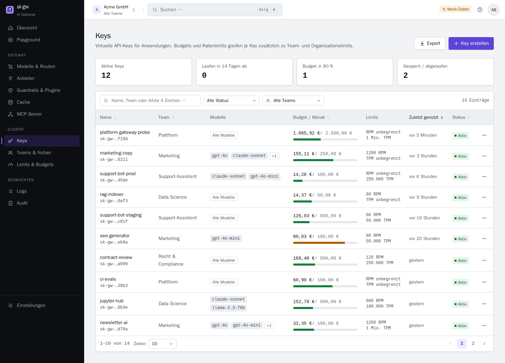 | 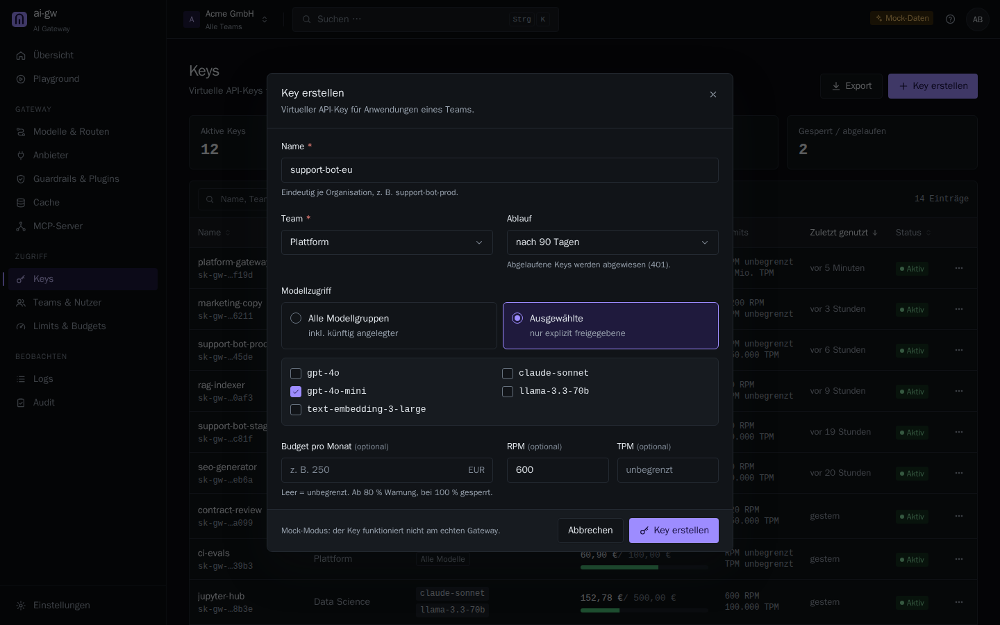 | 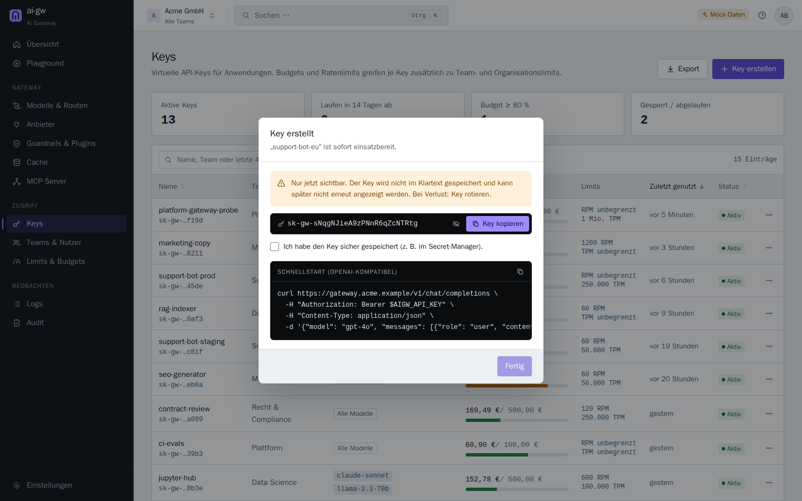 |

### 5.3 Modelle & Routen

Master/Detail: Modellgruppen (Alias, Strategie, Zustandspunkte je Deployment) → Detail mit Kennwerten
(Kontextfenster, Preise, Requests), **Deployments nach Prioritätsgruppen** (Anbieter, Upstream-Modell, Region,
Zustand, Gewichtsanteil, p95, Erfolgsquote) und **Fallback-Kette** (klickbar). Tab „Routing-Regeln“: Muster →
Modellgruppe, Teams, Notiz, aktiv (Switch); erste passende Regel gewinnt.

| Hell | Dunkel | Schmal |
|---|---|---|
|  | 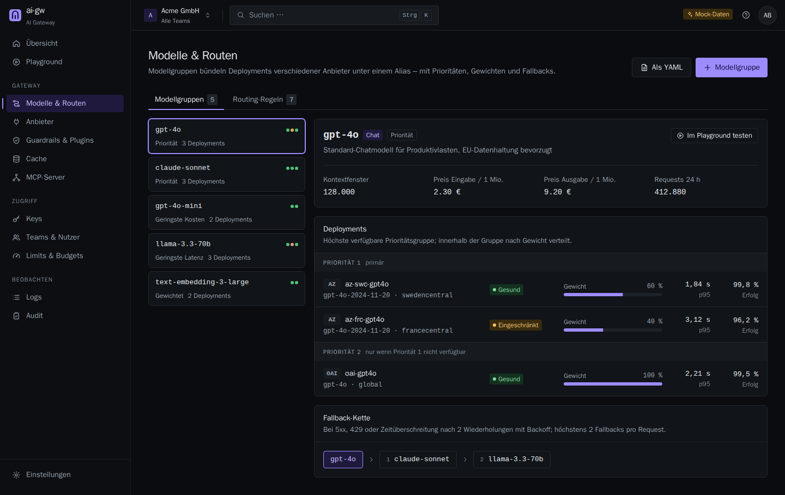 | 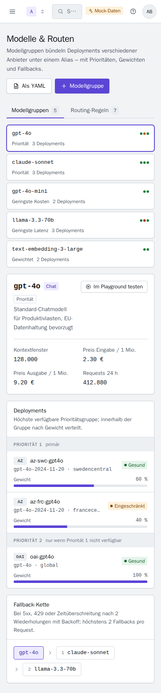 |

### 5.4 Logs-Explorer

Kennzahlen der Auswahl, Filter (Status, Modell, Cache, Suche nach Request-ID/Key/Modell), dichte Tabelle
(Zeit, Status, Modell + Anbieter + Fallback-/Messages-Hinweis, Key, Tokens ein→aus, Kosten, Latenz, Cache),
Live/Pause. **Detail-Sheet**: Übersicht (Endpunkt, Eingangsformat, Key, Team, Deployment, Tokens, Kosten, Latenz,
TTFB, Cache, Streaming, **Versuche** inkl. Fallback), Request- und Response-JSON, Zeitleiste der Gateway-Schritte
(Auth, Limits, Guardrails, Übersetzung über die IR, Upstream …).

| Liste | Detail (dunkel) | Detail schmal |
|---|---|---|
| 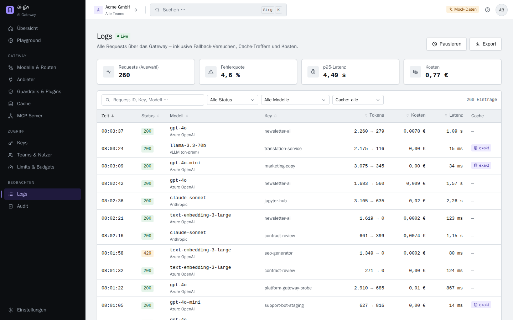 | 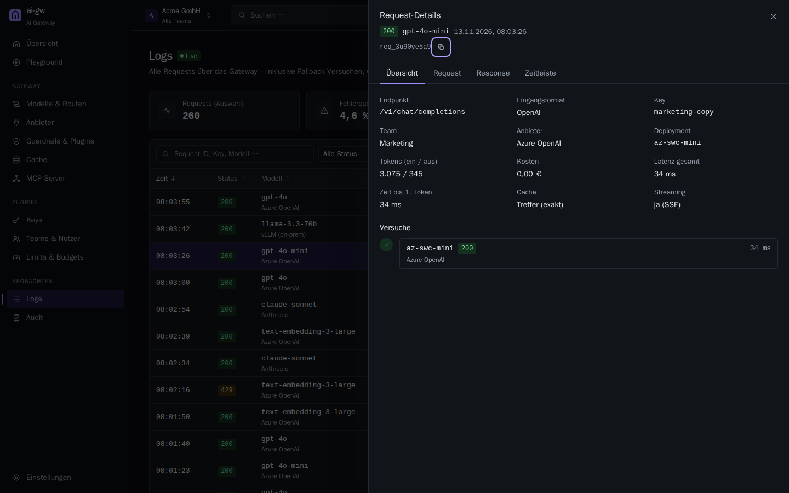 | 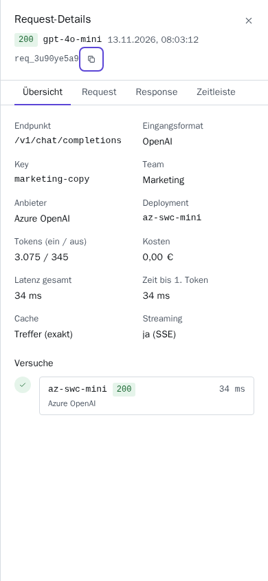 |

Weitere Screenshots (alle Kombinationen hell/dunkel × Desktop 1440 px/schmal 390 px) liegen unter `docs/konzept/ux/`;
neu erzeugen mit `ui/e2e/run.sh` (Ausgabe `ui/e2e/results/screens/`).

## 6. Seitenkatalog (alle geplanten Seiten)

| Seite | Pfad | Inhalt | Stand |
|---|---|---|---|
| Übersicht | `/` | Kennzahlen, Zeitreihen, Top-Modelle, Anbieterzustand, letzte Fehler, Gateway-Info | Muster |
| Playground | `/playground` | Chat gegen Modellgruppen/Routen, Vergleich mehrerer Modelle nebeneinander, Parameter, Kosten/Latenz je Antwort, Code-Snippets (OpenAI/Anthropic-SDK, curl) | geplant |
| Modelle & Routen | `/models` | Modellgruppen mit Deployments, Prioritäten, Gewichten, Fallbacks, Retry/Timeout; Routing-Regeln; Export als YAML | Muster |
| Anbieter | `/providers` | Upstream-Anbieter, Zugangsdaten-Referenzen (nie Klartext), Health-Checks, Circuit-Breaker-Zustand, Kontingente | geplant |
| Keys | `/keys` | Virtuelle Keys: erstellen (einmalige Anzeige), rotieren, sperren; Modelle, Budgets, Limits, Ablauf, Tags | Muster |
| Teams & Nutzer | `/teams` | Organisationen, Teams, Nutzer, Rollen (Admin/Team-Admin/Viewer), OIDC-Gruppen-Zuordnung, Einladungen | geplant |
| Limits & Budgets | `/limits` | RPM/TPM (gleitendes Fenster) und Budgets je Org/Team/Key/Modell; Verbrauch, Prognose, Schwellen-Alarme | geplant |
| Guardrails & Plugins | `/guardrails` | Eingangs-/Ausgangsprüfungen (PII, Prompt-Injection, Moderation), Webhook-/WASM-Plugins, Reihenfolge, Testlauf | geplant |
| Cache | `/cache` | Exakt/semantisch, Trefferquote, Ersparnis, TTL-Regeln, Vektorindex, gezieltes Leeren | geplant |
| MCP-Server | `/mcp` | MCP-Server und Tools, Freigaben je Team/Key, Aufrufprotokoll, Gesundheit | geplant |
| Logs | `/logs` | Request-Explorer mit Filtern, Detail-Sheet, Export | Muster |
| Audit | `/audit` | Unveränderliches Änderungsprotokoll der Steuerungsebene mit Diff, Filter, Export | geplant |
| Einstellungen | `/settings` | Darstellung, Datenquelle (Mock), Gateway-Konfiguration (YAML, lesend), OIDC, Aufbewahrung, Über | Teilmuster |
| Design-System | `/design` | Komponentenübersicht (Entwicklerseite, nicht in der Navigation, über Befehlspalette) | Muster |

Detailseiten (z. B. `/keys/{id}`, `/models/{alias}`, `/logs/{requestId}`) folgen dem Muster Kopf mit Status +
Aktionen, Tabs (Übersicht, Nutzung, Einstellungen, Audit).

## 7. CSP-Prüfung (Bits UI, Diagramm)

aigw-admin liefert die UI mit `default-src 'self'; script-src 'self'; style-src 'self'; img-src 'self' data:; …`
(`crates/aigw-admin/src/ui.rs`, unverändert). Geprüft im echten Chromium (Playwright 1.64.1) gegen das echte
`aigw serve` mit eingebetteter UI (`ui/e2e/run.sh`, Tests `ui/e2e/tests/csp.spec.js`):

| Geprüft | Ergebnis |
|---|---|
| Bits Select, DropdownMenu (Radio/Checkbox), Dialog, Sheet, Tooltip, Tabs, ToggleGroup, RadioGroup, Checkbox, Switch, Pagination | funktionieren, **0 CSP-Verstöße** |
| uPlot-Diagramm inkl. Hover-Tooltip, Theme-Wechsel | funktioniert, **0 CSP-Verstöße** |
| Befehlspalette, Toasts, mobile Navigation, Seitenwechsel | funktionieren, 0 Verstöße |
| Konsole (`securitypolicyviolation` + Konsolenfehler) | leer in allen 40 Tests (CSP- und Screenshot-Läufe) |

Warum es ohne Nonce/Hash geht: Bits UI (Floating-Positionierung, CSS-Variablen wie `--bits-select-anchor-width`)
und uPlot setzen Styles per **CSSOM** (`element.style…`, Svelte `set_style` → `style.cssText`); das ist von
`style-src` nicht erfasst. Verboten wären nur statische `style="…"`-Attribute im HTML/Template (betrifft Bits
`Command`, deshalb nicht verwendet) und `<style>`-Elemente zur Laufzeit. Regeln für eigenen Code: keine
`style="…"`-Attribute in Templates, Breiten/Positionen als SVG-Attribute (Meter, Sparkline, Zeitleiste) oder per
CSSOM; Vite baut CSS als Datei (`assetsInlineLimit: 0`). Eine CSP-Anpassung war **nicht nötig**.

## 8. Bundle und Qualität

| Messung (gzip -9, `pnpm sizes`) | Wert |
|---|---|
| initial JS (Shell, Svelte, Bits-Grundlagen) | 80,3 KiB (Brotli 71,5 KiB) |
| initial CSS | ≈ 8,5 KiB |
| alle Chunks JS (alle Seiten inkl. uPlot) | ≈ 164 KiB |
| gesamt (JS, CSS, HTML, SVG) | ≈ 174 KiB |

Seiten werden per dynamic import geladen; uPlot (~20 KiB gzip) nur mit der Übersicht. `svelte-check`, `vite build`
und `scripts/check.sh` sind grün; Browser-Tests: `ui/e2e/run.sh` (eigenes pnpm-Projekt, nicht im Bundle).

## 9. Offene Designfragen (Entscheidung durch den User)

| # | Frage | Optionen | Empfehlung |
|---|---|---|---|
| D1 | Akzentfarbe | **Violett** `#5b45d6` (eigenständig, „AI“-typisch) · Petrol `#0f6f68` (Familienlook cloud-project) · Bernstein `#b45309` (warm, aber nah an Warnfarben) – live umschaltbar in Einstellungen | Violett: klar unterscheidbar von cloud-project und von allen Statusfarben |
| D2 | Diagramm-Bibliothek | **uPlot** (Canvas, ~20 KiB gzip, sehr schnell bei vielen Punkten, CSP-geprüft) · LayerChart (Svelte-nativ/SVG, schöner deklarativ, aber d3-Abhängigkeiten, deutlich größer) · Eigenbau SVG (wie Sparkline; minimal, aber Achsen/Hover selbst pflegen) | uPlot für Zeitreihen, eigene SVG-Bausteine für Kleinstgrafiken (Sparkline, Meter, Balken) |
| D3 | Schrift | Systemschrift (heute) · Inter selbst gehostet (`font-src 'self'`, ~100 KiB woff2) | Systemschrift beibehalten; Inter nur, falls einheitlicher Look über Plattformen gewünscht |
| D4 | Zahlen in Monospace | Variante C nutzt Monospace für alle Zahlen; KPI-Kacheln jetzt Sans mit Tabellenziffern | Mischung wie umgesetzt (Tabellen/IDs mono, große Kennzahlen sans) |
| D5 | Seitenleiste im Hellmodus | dunkel (Variante C) · hell | dunkel (Variante C, klare Trennung von Navigation und Inhalt) |
| D6 | Mock-Modus Standard | an, solange Endpunkte fehlen · aus | an bis zur ersten echten Daten-API, dann aus und nur per `?mock=1`/Einstellung |
