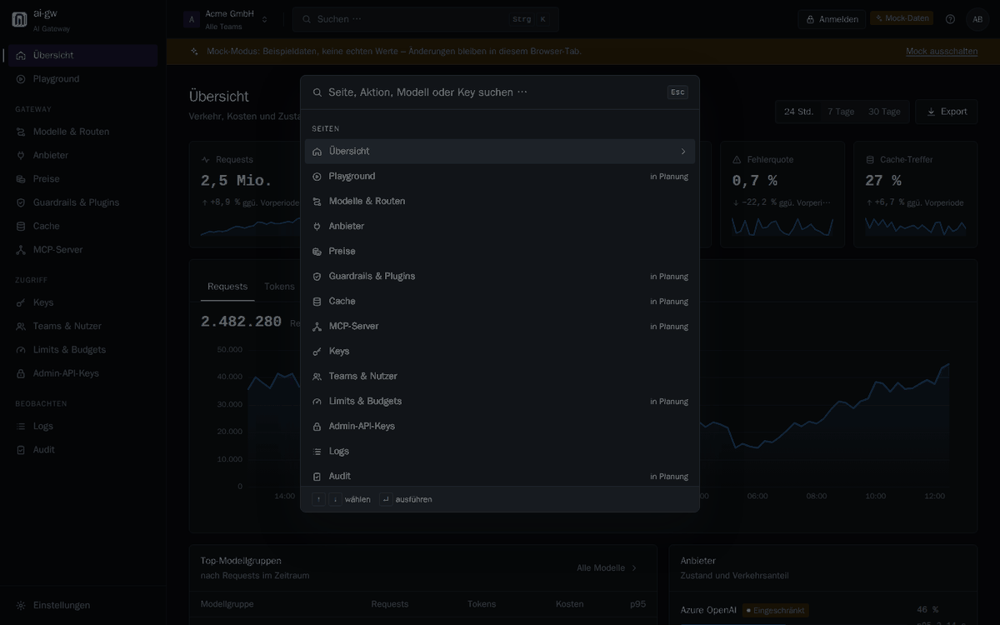
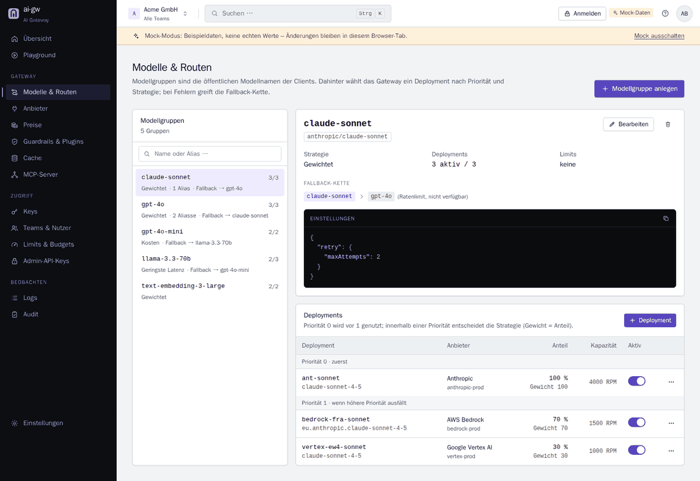
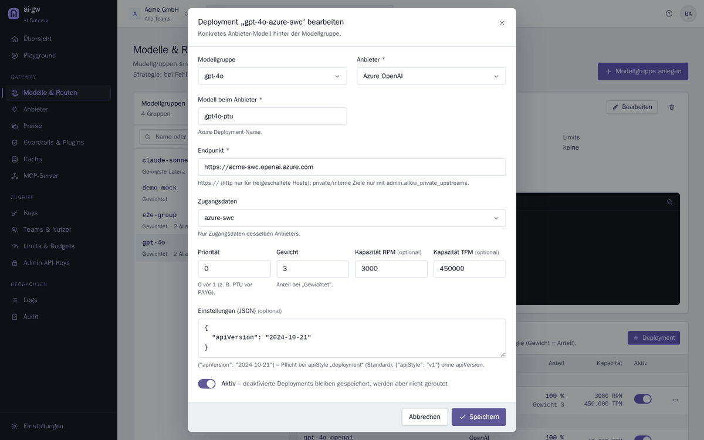
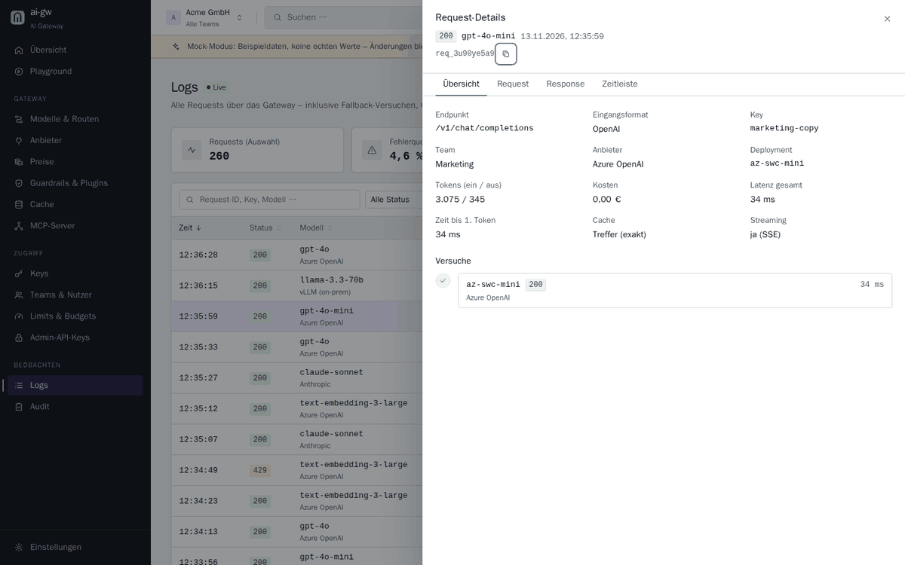
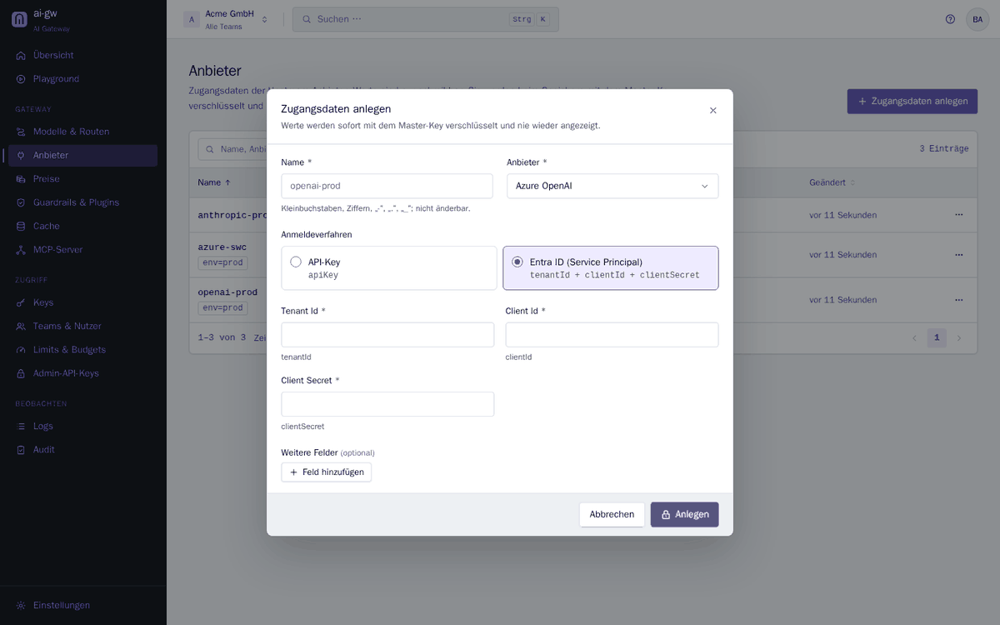
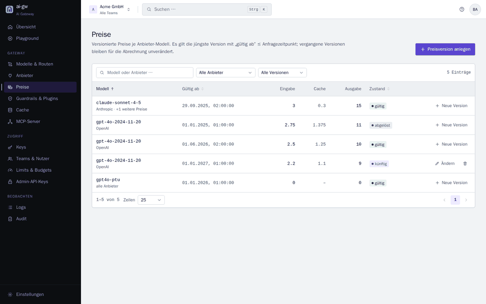

# 04 – UX-Konzept und Design-System der Admin-UI

> Status: **Entwurf zur Abnahme** (AIGW-48, Verwaltungsseiten AIGW-49) · Stand: 2026-11-13 · Grundlage: cloud-project-Portal, Variante C
> „Technisch“ (CLOU-106), Vorbild Cloudflare-Dashboard · Umsetzung: `ui/` (Svelte 5, Vite, Bits UI, Tailwind 4)
>
> Designfragen D1–D6 sind entschieden (§9: Violett, Monospace für alle Zahlen, dunkle Seitenleiste,
> Systemschrift, Mock-Modus standardmäßig aus, uPlot + eigene SVG); offen sind D7–D12. Ältere Hinweise auf
> „umschaltbare Alternativen“ betreffen nur noch das Farbschema; die Musterseiten zeigen jeweils den Vorschlag, Alternativen sind umschaltbar.

## 1. Ziel und Prinzipien

Die Admin-UI soll sich wie ein hochwertiges SaaS-Produkt anfühlen (Cloudflare, Vercel, Portkey), nicht wie ein
technisches Konfigurationsformular. Inhaltlich orientiert sie sich an LiteLLM Admin UI, Kong Konnect AI Gateway,
Azure API Management/AI Foundry, Portkey und Cloudflare AI Gateway.

1. **Übersicht zuerst.** Jede Bereichsseite beginnt mit dem Zustand (Kennzahlen, Status), dann folgt die Liste,
   dann das Detail. Zahlen immer mit Einheit und Vergleich (Vorperiode).
2. **Ruhig und dicht.** Neutrale Flächen, eine Akzentfarbe nur für Aktion/Auswahl, Statusfarben nur für Status.
   14-px-Grundschrift, 4-px-Raster, kleine Radien (Variante C). Tabellen sind das Hauptwerkzeug.
3. **Detail ohne Kontextverlust.** Details als Sheet (Seitenpanel) oder Master/Detail statt Seitenwechsel; Dialoge
   nur für Bestätigungen und kurze Formulare.
4. **Sicher by Design.** Secrets werden genau einmal im Klartext gezeigt; destruktive Aktionen brauchen Bestätigung
   mit Klartext-Folgen; Mock-Daten sind immer sichtbar gekennzeichnet.
5. **Barrierefrei.** Bits UI für alle komplexen Widgets (Fokusfalle, Tastatur, ARIA); Status nie nur über Farbe
   (immer Text/Icon); Fokus-Ring über Token; `prefers-reduced-motion` schaltet Bewegung ab.
6. **Strikte CSP ohne Ausnahme.** Keine Inline-Skripte/-Styles, keine externen Fonts/CDNs; Geometrie über
   SVG-Attribute oder CSSOM (siehe §7).
7. **Alles per Tastatur.** Befehlspalette (⌘K/Strg+K) für Navigation und häufige Aktionen.

## 2. Design-Tokens

Quelle: `ui/src/styles/tokens.css` (Tailwind-4-`@theme`). Die Standardpalette von Tailwind ist abgeschaltet
(`--color-*: initial`), es gibt nur semantische Tokens. Aus Variante C übernommen: neutrale Flächen, Radien,
Monospace für Zahlen in Tabellen, dunkle Seitenleiste auch im Hellmodus; für ai-gw eigenständig benannt
(Utilities `bg-surface`, `text-fg-muted`, `border-line`, `bg-accent` …).

### 2.1 Farben (hell / dunkel)

| Token | Hell | Dunkel | Verwendung |
|---|---|---|---|
| `bg` | `#f1f3f5` | `#0a0c0f` | Seitenhintergrund |
| `surface` / `surface-2` / `surface-hover` | `#ffffff` / `#edf0f3` / `#e5e9ed` | `#111418` / `#171b20` / `#1d2228` | Karten, Tabellenkopf, Hover |
| `line` / `line-strong` | `#d6dbe1` / `#7b8592` | `#242a32` / `#66717e` | Ränder, Eingabe-Hover |
| `fg` / `fg-muted` / `fg-subtle` | `#101418` / `#505965` / `#6b7480` | `#e1e6eb` / `#98a2ae` / `#7f8995` | Text |
| `accent` (+ `-hover`, `on-accent`, `accent-text`, `accent-soft`, `accent-soft-fg`, `focus`) | `#5b45d6` | `#9d8cff` | Primäraktion, Auswahl, Fokus |
| `success` / `warning` / `danger` / `info` / `neutral` (je `-bg`, `-fg`) | z. B. `#e5f4ea`/`#17652f` | `#143120`/`#86dba0` | nur Status |
| `sidebar`, `sidebar-line` | `#0c0e11` | `#0c0e11` | Seitenleiste (immer dunkel) |
| `code`, `code-fg`, `code-*` | `#0e1115` | `#0b0c0e` | Code-/Key-Anzeige (immer dunkel) |
| `chart-1` … `chart-6` | `#2a78d6` `#eb6834` `#1baf7a` `#eda100` `#e87ba4` `#6250d6` | `#3987e5` `#d95926` `#199e70` `#c98500` `#d55181` `#9085e9` | Diagramm-Serien, feste Reihenfolge |

Hell/Dunkel: helle Werte im `@theme`, dunkle als Block für `<html data-theme="dark">` **und** für Teilbäume mit
`.scheme-dark` (Seitenleiste, Code). Bewusst ohne `light-dark()`, weil Lightning CSS es für ältere Browser durch am
`<html>` aufgelöste Variablen ersetzt – dunkle Teilbäume im Hellmodus funktionierten damit nicht (im Browser geprüft).

Diagrammfarben: kategoriale Reihenfolge ist fest (nie zyklisch, nie nach Rang), Statusfarben sind keine Serien;
eine Serie = eine Achse, Kreuz + Tooltip beim Überfahren, Bildschirmleser-Zusammenfassung (min/max/zuletzt).

### 2.2 Typografie, Abstände, Radien, Schatten, Bewegung

| Kategorie | Werte |
|---|---|
| Schrift | Systemschriften (`system-ui …`), Monospace `ui-monospace …`; keine Webfonts (CSP, Größe) |
| Größen | `2xs` 11 · `xs` 12 · `sm` 13 · **`base` 14** · `md` 16 · `lg` 18 · `xl` 22 · `2xl` 28 px |
| Zahlen | `.num` = Monospace + Tabellenziffern für **alle** Zahlen (Tabellen, IDs, KPI-Kacheln; D4) |
| Etiketten | `.label-caps` 11 px, Versalien, Laufweite 0,08 em (Gruppenüberschriften) |
| Abstände | Tailwind-Raster 4 px; Seitenränder 16/24/32 px; Kartenabstand 16 px |
| Radien | `xs` 2 · `sm` 3 · `md` 4 · `lg` 6 · `xl` 8 px (Dialoge) |
| Schatten | `card` (Kontur + 1 px), `pop` (Menüs/Popover), `dialog` (Dialoge/Sheets) |
| Bewegung | 140–240 ms, `ease-out`; Pop/Fade/Dialog/Sheet/Toast; aus bei `prefers-reduced-motion` |
| Layout | Seitenleiste 240 px (ab `lg` = 1024 px), Topbar 56 px, Inhalt max. 1440 px |

### 2.3 Farbschema-Umschaltung

`System | Hell | Dunkel` im Nutzer-Menü, in den Einstellungen und in der Befehlspalette (`prefs.svelte.ts`,
gespeichert in `localStorage`). Am `<html>` steht immer das wirksame Schema (`data-theme`), damit ändert sich bei
„System“ die Darstellung live mit dem Betriebssystem. Vorbelegung per URL: `?theme=dark&mock=1`.

## 3. App-Shell und Navigation

- **Seitenleiste** (dunkel, ab 1024 px fest, darunter als Sheet hinter dem Menü-Button) mit Gruppen:

| Gruppe | Einträge |
|---|---|
| – | Übersicht, Playground |
| Gateway | Modelle & Routen, Anbieter, Preise, Guardrails & Plugins, Cache, MCP-Server |
| Zugriff | Keys, Teams & Nutzer, Limits & Budgets, Admin-API-Keys (nur globale Admins) |
| Beobachten | Logs, Audit |
| (unten) | Einstellungen |

- **Topbar:** Organisation/Team-Umschalter (Dropdown mit Radiogruppen; Team filtert Listen), Suche als Auslöser der
  **Befehlspalette** (⌘K/Strg+K: Seiten, Aktionen, Modellgruppen, Keys), Hinweis „Mock-Daten“ (klickbar zum
  Ausschalten), Hilfe, **Nutzer-Menü** (Identität/Rolle, Farbschema, Mock-Daten, Einstellungen, API-Doku, Abmelden).
- **Routing:** echte Pfade unter `/admin/…` (History-API; aigw-admin liefert für Pfade ohne Endung `index.html`),
  Seiten per dynamic import, Fokus nach Seitenwechsel auf die `h1`, „Zum Inhalt springen“-Link.
- **Responsiv:** < 640 px eine Spalte, Tabellen blenden Nebenspalten aus (`from: 'md' | 'lg' | 'xl'`), Filter
  umbrechen; Dialoge maximal Bildschirmhöhe mit scrollendem Inhalt.

| Befehlspalette | Übersicht (dunkel) | Befehlspalette (dunkel) |
|---|---|---|
|  |  |  |

## 4. Komponenten

Alle interaktiven Bausteine basieren auf **Bits UI 2** (headless) und werden über Klassen-Rezepte
(`ui/src/lib/ui/styles.ts`) gestylt; Übersicht unter `/admin/design`.

| Komponente | Datei | Basis | Hinweise |
|---|---|---|---|
| Button (primary, secondary, ghost, danger, link; sm/md/icon; loading; als Link) | `Button.svelte` | `<button>`/`<a>` | Rezept `btn()` auch für Bits-Trigger |
| Input (Icon, Suffix), Formularmuster `Field` | `Input.svelte`, `Field.svelte` | nativ | Label oben, Hilfe/Fehler per `aria-describedby`, Fehler ersetzt Hilfe, Validierung beim Absenden, Fokus aufs erste fehlerhafte Feld |
| Select | `Select.svelte` | Bits `Select` | Typeahead, Hinweiszeile je Option |
| Checkbox, RadioGroup (Karten), Switch | direkt Bits | Bits | Karten-Radio für Entscheidungen mit Erklärung |
| Dialog | `Dialog.svelte` | Bits `Dialog` | Kopf/Inhalt/Fußzeile, `dismissible=false` für Pflichtbestätigung |
| Sheet | `Sheet.svelte` | Bits `Dialog` | rechts (Details) / links (mobile Navigation) |
| Dropdown-Menü | Bits `DropdownMenu` + `menuItem` | Bits | Radio-/Checkbox-Einträge, Gefahrenaktion rot und zuletzt |
| Tabs, Segment-Umschalter | Bits `Tabs`, `ToggleGroup` + Rezepte | Bits | Unterstrich-Tabs, Segment für Zeitraum |
| Tooltip | `Tooltip.svelte` | Bits `Tooltip` | nur ergänzend, Trigger bleibt eigenes Element |
| Badge / Status | `Badge.svelte` | – | Töne neutral/accent/success/warning/danger/info/outline, Punkt, Monospace |
| Tabelle | `DataTable.svelte` | Bits `Pagination` | Suche, Filter-Slot, Sortierung (`aria-sort`), Pagination + Zeilen/Seite, Kein-Treffer-Zustand mit „Filter zurücksetzen“, klickbare Zeilen |
| Karte, KPI-Kachel, Sparkline, Meter | `Card`, `KpiTile`, `Sparkline`, `Meter` | SVG | Veränderung als Pfeil + Text, Bewertung „besser = hoch/niedrig“; Budget-Meter ab 80 % gelb, ab 95 % rot |
| Zeitreihen-Diagramm | `TimeSeriesChart.svelte` | uPlot | Token-Farben, Kreuz + Tooltip, Neuzeichnen bei Schemawechsel |
| Leerer Zustand | `EmptyState.svelte` | – | Icon, Titel, Erklärung, nächste Aktion; auch „API noch nicht verfügbar“ |
| Toast | `Toaster.svelte`, `toast.svelte.ts` | aria-live | pausiert bei Hover/Fokus, Fehler als `role=alert` |
| Code-/JSON-Anzeige | `CodeBlock.svelte` | – | immer dunkel, Hervorhebung ohne `{@html}`, Kopieren |
| Einmalige Key-Anzeige | `SecretReveal.svelte` | Bits `Checkbox` | Warnhinweis, Kopieren, Verbergen, „gespeichert“-Bestätigung schaltet „Fertig“ frei |
| Kopieren | `CopyButton.svelte` | Clipboard-API | sichtbare + vorgelesene Bestätigung |
| Seitenkopf | `PageHeader.svelte` | – | Titel, Beschreibung, Badge, Aktionen |
| Shell | `lib/shell/*` | Bits | Seitenleiste, Topbar, Kontext-Umschalter, Nutzer-Menü, Befehlspalette |

Befehlspalette: eigenes APG-Muster (Combobox + Listbox mit `aria-activedescendant`) im Bits-Dialog, weil
**Bits UI `Command` statische `style`-Attribute rendert** (CSP `style-src-attr`) – Befund aus dem cloud-project-Spike,
für bits-ui 2.20.6 im Quelltext erneut bestätigt (einzige Bits-Komponente mit statischen Styles).

## 5. Musterseiten (klickbar, Mock-Daten)

Mock-Modus (D6): **standardmäßig aus**; einschalten nur per Schalter (Einstellungen, Nutzer-Menü, Befehlspalette)
oder `?mock=1` (gilt nur für den Aufruf). Eingeschaltet ist er **deutlich gekennzeichnet**: gelbes Band unter der
Topbar („Mock-Modus: Beispieldaten …“, mit „Mock ausschalten“) plus Badge in der Topbar. Übersicht und Logs zeigen
Beispieldaten (`lib/data.svelte.ts`, fester Seed), bis Rollups/Logs mit AIGW-46/53 als Endpunkte kommen; ohne Mock
einen Leerzustand. Die Verwaltungsseiten (§5.5) laufen im Mock-Modus über dasselbe API-Modul gegen ein
In-Memory-Backend (`lib/mock/backend.ts`). Die Gateway-Version kommt immer von der echten API.

### 5.1 Übersicht

KPI-Kacheln (Requests, Tokens, Kosten, p95-Latenz, Fehlerquote, Cache-Treffer; Veränderung zur Vorperiode und
Mini-Verlauf), Zeitraum 24 Std./7 Tage/30 Tage, Zeitreihe je Kennzahl (Tabs), Top-Modellgruppen, Anbieter mit
Zustand und Verkehrsanteil, letzte Fehler (→ Log-Explorer), Gateway-Info (Version live).

| Hell | Dunkel |
|---|---|
|  |  |

### 5.2 Keys

Seit AIGW-49 echte Seite (§5.5); die Bilder unten zeigen sie im Mock-Modus. Kennzahlen (aktiv, laufen in 14 Tagen
ab, gesperrt, abgelaufen), Tabelle mit Name + `sk-aigw-<Präfix>…`, Team, Modellen, Budget & Limits, Ablauf, letzter
Nutzung, Status; Filter Status/Team (serverseitig), Suche, Sortierung, Pagination; Zeilenmenü (Bearbeiten, Rotieren,
Name kopieren, Sperren/Entsperren, Löschen – je mit Bestätigung). **„Key erstellen“**: Formular (Name, Team, Ablauf,
Nutzer, Modellzugriff alle/ausgewählte, Budget mit Zeitraum, RPM/TPM) → **einmalige Klartext-Anzeige** mit
Schnellstart-Snippet. Verbrauch je Budget (Meter) folgt mit `GET /usage/budgets` (AIGW-30/31) in AIGW-50.

| Liste | Erstellen (dunkel) | Einmalige Anzeige |
|---|---|---|
|  |  |  |

### 5.3 Modelle & Routen

Seit AIGW-49 echte Seite (§5.5). Master/Detail: Modellgruppen (Name, Strategie, Aliasse, aktive/alle Deployments)
→ Detail mit Aliassen, Strategie, **Fallback-Kette** (klickbar, Auslöser je Ziel), Einstellungen (JSON) und
**Deployments nach Prioritätsgruppen** (Anbieter, Zugangsdaten, Anbieter-Modell, Endpunkt, Gewichtsanteil,
Kapazität, aktiv-Schalter). Die Musterseite aus AIGW-48 zeigte zusätzlich Zustand/p95/Erfolgsquote je Deployment
und einen Tab „Routing-Regeln“ – Laufzeitwerte folgen mit AIGW-46, Routing-Regeln gibt es in der API nicht
(Aliasse übernehmen die Aufgabe, siehe §9 D10).

| Hell (Mock) | Dunkel (Mock) | Deployment bearbeiten (echt) |
|---|---|---|
|  |  |  |

### 5.4 Logs-Explorer

Kennzahlen der Auswahl, Filter (Status, Modell, Cache, Suche nach Request-ID/Key/Modell), dichte Tabelle
(Zeit, Status, Modell + Anbieter + Fallback-/Messages-Hinweis, Key, Tokens ein→aus, Kosten, Latenz, Cache),
Live/Pause. **Detail-Sheet**: Übersicht (Endpunkt, Eingangsformat, Key, Team, Deployment, Tokens, Kosten, Latenz,
TTFB, Cache, Streaming, **Versuche** inkl. Fallback), Request- und Response-JSON, Zeitleiste der Gateway-Schritte
(Auth, Limits, Guardrails, Übersetzung über die IR, Upstream …).

| Liste | Detail (dunkel) | Detail (hell) |
|---|---|---|
|  |  |  |

Im Repo liegen nur Desktop-Screenshots hell/dunkel, auf 1200 px Breite und 64 Farben reduziert, nur die hier eingebundenen (≈ 1,2 MB)
(`docs/konzept/ux/`, `python3 ui/e2e/docs-screens.py ui/e2e/results/screens docs/konzept/ux`). Alle weiteren
Varianten (schmal 390 px, Detailzustände) erzeugt `ui/e2e/run.sh` als nicht eingechecktes Artefakt
(`ui/e2e/results/screens/`).

### 5.5 Verwaltungsseiten gegen die echte Admin-API (AIGW-49)

Screenshots mit Präfix `echt-` entstehen gegen ein echtes `aigw serve` (Daten per Admin-API angelegt,
Anmeldung per Bootstrap-Token, `ui/e2e/tests/real-screens.spec.js`; hell und dunkel).

| Keys | Modelle & Routen (dunkel) | Anbieter: Zugangsdaten anlegen |
|---|---|---|
|  |  |  |
| **Preise** | **Teams** | **GitOps-Trockenlauf (Diff)** |
|  |  |  |

| Seite | Inhalt | Schreibaktionen sichtbar für (Admin-API §5.4) |
|---|---|---|
| `/teams` (Tabs Organisationen, Teams, Nutzer) | Liste, Detail-Sheet (Metadaten + `spec`), Anlegen/Bearbeiten/Löschen; Nutzer mit Rollen-Editor (Rolle + Organisation/Team) und OIDC-Verknüpfung | Organisation anlegen und Nutzer: globaler Admin; Organisation ändern: Admin der Organisation; Teams: Admin/Org-Admin |
| `/keys` | wie §5.2; Rotation mit Name + Übergangszeit → neuer Klartext einmalig | Admin/Org-Admin/Team-Admin im Bereich des Teams; Keys ohne Team nur global |
| `/models` | wie §5.3; Formulare für Gruppe (Aliasse, Strategie, Fallbacks mit Auslösern und Reihenfolge, Einstellungen als JSON mit Feldliste) und Deployment (Anbieter, Modell, Endpunkt je Anbieter Pflicht/optional, Zugangsdaten desselben Anbieters, Priorität, Gewicht, RPM/TPM, aktiv, Einstellungen mit Hinweisen je Anbieter) | globaler Admin (Katalog) |
| `/providers` | Anbieter-Zugangsdaten **ohne Werte** (Feldnamen, Labels, Verwendung durch Deployments); Anlegen und „Alle Werte ersetzen“ (PUT) mit Pflichtfeldern je Anbieter und Alternativen (z. B. Azure: API-Key **oder** Entra ID), „Werte ändern“ (PATCH/Merge Patch: einzeln setzen/entfernen) | globaler Admin |
| `/prices` | Versionen je (Anbieter, Modell) mit Zustand gültig/abgelöst/künftig; „Neue Version“ mit Vorlage; künftige ändern/löschen | globaler Admin |
| `/admin-keys` | Admin-API-Keys mit Rollen, Ablauf, letzter Nutzung; Anlegen → Klartext einmalig; Bearbeiten, Widerrufen | nur globaler Admin (auch der Navigationseintrag) |
| `/settings` | Anmeldung (Name, Verfahren, Rollen, Ablauf, Abmelden), Hinweis Nur-YAML-Modus, GitOps-Export (Download) und -Apply (Trockenlauf → Diff → Anwenden), Datenquelle, Darstellung | Export: globale Leserolle; Apply: globaler Admin |

**API-Client** (`ui/src/lib/api/client.ts`, `resources.ts`): openapi-fetch mit den generierten Typen
(`schema.d.ts`); generische Abläufe je Ressource (`list` folgt `nextCursor` bis zum Ende, `listPage` liefert eine
Seite, `get` liefert das ETag, `update`/`remove`/Aktionen senden es als `If-Match`); Fehler als `ApiError` aus
Problem Details. Einheitliche Behandlung in `lib/admin/errors.svelte.ts`:

| Antwort | UI |
|---|---|
| `412 precondition-failed` | Konflikt-Dialog „Zwischenzeitlich geändert“ mit **Neu laden** (verwirft die Eingaben, lädt Stand + ETag) |
| `400/409/422` im Formular | Fehlermeldung (Problem-`detail`) im Formular, Dialog bleibt offen; außerhalb von Formularen Toast |
| `403 read-only` | Toast + Hinweis „Nur-YAML-Modus“ in den Einstellungen |
| `403` beim Laden | Leerzustand „Keine Berechtigung“ |
| `401` | mit OIDC: Weiterleitung zum Login (`returnTo`); ohne OIDC: Token-Dialog |
| Netzwerk | Fehlerzustand mit „Erneut versuchen“ |

**Anmeldung** (`lib/session.svelte.ts`): Start mit `GET /auth/info`. Mit OIDC wie bisher Login-Weiterleitung und
CSRF-Token der Session für schreibende Anfragen. Ohne OIDC (Bootstrap-Token bzw. Admin-API-Keys) öffnen „Anmelden“
(Topbar, Nutzer-Menü, Einstellungen, Seitenhinweis) bzw. ein 401 den **Token-Dialog**; das Token wird über
`auth/info` geprüft und **nur im `sessionStorage`** des Tabs gehalten (nie `localStorage`), Abmelden löscht es.
Ohne OIDC und ohne Token öffnet sich der Token-Dialog beim Start (Mock ist standardmäßig aus); Verwaltungsseiten
ohne Anmeldung zeigen statt Abfragen einen Anmelde-Hinweis (keine 401-Flut).

**Rollen** (`lib/rbac.svelte.ts`): Nachbau von `aigw-admin/src/rbac.rs`, nur zum **Ausblenden** von
Schreibaktionen (Buttons, Zeilenmenüs, Schalter, Navigationseintrag Admin-API-Keys); entscheiden tut der Server.

**Zustände**: Laden (Skelett), Fehler (mit Wiederholen), leer (Erklärung + nächste Aktion nur mit Schreibrecht),
keine Treffer (Filter zurücksetzen). Destruktive Aktionen mit Bestätigungsdialog und Klartext-Folgen; Secrets
(API-Keys, Admin-API-Keys) einmalig über `SecretDialog`, Werte von Zugangsdaten nur als Passwortfelder.

**Mock-Backend** (`lib/mock/backend.ts`, eigener Chunk, nur im Mock-Modus geladen): bedient dieselben Pfade wie die
Admin-API mit ETag/If-Match, Cursor-Pagination, Problem Details und den wichtigsten Prüfungen (Namen, Verweise,
Löschsperren, Alias-Kollision, Pflichtfelder der Zugangsdaten, unveränderliche Preise) – ein Code-Pfad für Mock und
Echtbetrieb. Audit-Log (`/audit`, AIGW-66) und Budget-Verbrauch (AIGW-30/31) sind noch nicht angebunden (AIGW-50).

**E2E** (`ui/e2e/tests/admin.spec.js`, gegen `aigw serve` mit Bootstrap-Token aus `run.sh`): Anmeldung per
Token-Dialog (falsches Token → Fehler, richtiges → echte Daten, Token nur im sessionStorage); Key anlegen →
Klartext genau einmal, Liste und API zeigen nur das Präfix, Klartext nach Schließen/Neuladen nicht im DOM;
Modellgruppe + Mock-Deployment anlegen; ETag-Konflikt (paralleles PUT) → Dialog → Neu laden → Speichern;
Viewer-Admin-API-Key sieht keine Schreibaktionen.

## 6. Seitenkatalog (alle geplanten Seiten)

| Seite | Pfad | Inhalt | Stand |
|---|---|---|---|
| Übersicht | `/` | Kennzahlen, Zeitreihen, Top-Modelle, Anbieterzustand, letzte Fehler, Gateway-Info | Muster |
| Playground | `/playground` | Chat gegen Modellgruppen/Routen, Vergleich mehrerer Modelle nebeneinander, Parameter, Kosten/Latenz je Antwort, Code-Snippets (OpenAI/Anthropic-SDK, curl) | geplant |
| Modelle & Routen | `/models` | Modellgruppen mit Deployments, Prioritäten, Gewichten, Fallbacks, Einstellungen; Laufzeitwerte folgen (AIGW-46) | **echt** (AIGW-49) |
| Anbieter | `/providers` | Anbieter-Zugangsdaten (nie Klartext), Verwendung; später Health-Checks, Circuit-Breaker-Zustand | **echt** (Zugangsdaten) |
| Preise | `/prices` | Preisversionen je Anbieter-Modell | **echt** |
| Keys | `/keys` | Virtuelle Keys: erstellen (einmalige Anzeige), rotieren, sperren; Modelle, Budgets, Limits, Ablauf | **echt** |
| Teams & Nutzer | `/teams` | Organisationen, Teams, Nutzer, Rollen; später Einladungen | **echt** |
| Admin-API-Keys | `/admin-keys` | Zugänge für Automatisierung mit Rollen und Ablauf | **echt** |
| Limits & Budgets | `/limits` | RPM/TPM (gleitendes Fenster) und Budgets je Org/Team/Key/Modell; Verbrauch, Prognose, Schwellen-Alarme | geplant |
| Guardrails & Plugins | `/guardrails` | Eingangs-/Ausgangsprüfungen (PII, Prompt-Injection, Moderation), Webhook-/WASM-Plugins, Reihenfolge, Testlauf | geplant |
| Cache | `/cache` | Exakt/semantisch, Trefferquote, Ersparnis, TTL-Regeln, Vektorindex, gezieltes Leeren | geplant |
| MCP-Server | `/mcp` | MCP-Server und Tools, Freigaben je Team/Key, Aufrufprotokoll, Gesundheit | geplant |
| Logs | `/logs` | Request-Explorer mit Filtern, Detail-Sheet, Export | Muster |
| Audit | `/audit` | Unveränderliches Änderungsprotokoll der Steuerungsebene mit Diff, Filter, Export | geplant |
| Einstellungen | `/settings` | Anmeldung/Rollen, Nur-YAML-Hinweis, GitOps Export/Apply, Datenquelle, Darstellung, Über | **echt** |
| Design-System | `/design` | Komponentenübersicht (Entwicklerseite, nicht in der Navigation, über Befehlspalette) | Muster |

Detailseiten (z. B. `/keys/{id}`, `/models/{alias}`, `/logs/{requestId}`) folgen dem Muster Kopf mit Status +
Aktionen, Tabs (Übersicht, Nutzung, Einstellungen, Audit).

## 7. CSP-Prüfung (Bits UI, Diagramm)

aigw-admin liefert die UI mit `default-src 'self'; script-src 'self'; style-src 'self'; img-src 'self' data:; …`
(`crates/aigw-admin/src/ui.rs`, unverändert). Geprüft im echten Chromium (Playwright 1.64.1) gegen das echte
`aigw serve` mit eingebetteter UI (`ui/e2e/run.sh`, Tests `ui/e2e/tests/csp.spec.js`):

| Geprüft | Ergebnis |
|---|---|
| Bits Select, DropdownMenu (Radio/Checkbox), Dialog, Sheet, Tooltip, Tabs, ToggleGroup, RadioGroup, Checkbox, Switch, Pagination | funktionieren, **0 CSP-Verstöße** |
| uPlot-Diagramm inkl. Hover-Tooltip, Theme-Wechsel | funktioniert, **0 CSP-Verstöße** |
| Befehlspalette, Toasts, mobile Navigation, Seitenwechsel | funktionieren, 0 Verstöße |
| Verwaltungsseiten gegen echtes `aigw serve` (Token-Dialog, Formulare, Konflikt-Dialog, Sheets, Rollen-Ausblendung) | funktionieren, 0 CSP-Verstöße (`admin.spec.js`, `real-screens.spec.js`) |
| Konsole (`securitypolicyviolation` + Konsolenfehler) | leer in allen 66 Tests; einzige erlaubte Meldung: Chromiums „Failed to load resource … 412“ im absichtlich provozierten ETag-Konflikt |

Warum es ohne Nonce/Hash geht: Bits UI (Floating-Positionierung, CSS-Variablen wie `--bits-select-anchor-width`)
und uPlot setzen Styles per **CSSOM** (`element.style…`, Svelte `set_style` → `style.cssText`); das ist von
`style-src` nicht erfasst. Verboten wären nur statische `style="…"`-Attribute im HTML/Template (betrifft Bits
`Command`, deshalb nicht verwendet) und `<style>`-Elemente zur Laufzeit. Regeln für eigenen Code: keine
`style="…"`-Attribute in Templates, Breiten/Positionen als SVG-Attribute (Meter, Sparkline, Zeitleiste) oder per
CSSOM; Vite baut CSS als Datei (`assetsInlineLimit: 0`). Eine CSP-Anpassung war **nicht nötig**.

## 8. Bundle und Qualität

| Messung (gzip -9, `pnpm sizes`) | AIGW-48 | AIGW-49 |
|---|---|---|
| initial JS (Shell, Svelte, Bits-Grundlagen; ab AIGW-49 + API-Client, Anmeldung, Token-/Konflikt-Dialog) | 80,3 KiB | 91,6 KiB (Brotli 81,3 KiB; Budget ≤ 120 KiB) |
| initial CSS | ≈ 8,5 KiB | ≈ 8,7 KiB |
| alle Chunks JS (alle Seiten inkl. uPlot und Mock-Backend) | ≈ 164 KiB | ≈ 215 KiB |

Seiten werden per dynamic import geladen; uPlot (~20 KiB gzip) nur mit der Übersicht, das Mock-Backend nur im
Mock-Modus. `svelte-check`, `vite build`
und `scripts/check.sh` sind grün; Browser-Tests: `ui/e2e/run.sh` (eigenes pnpm-Projekt, nicht im Bundle).

## 9. Offene Designfragen (Entscheidung durch den User)

| # | Frage | Optionen | Empfehlung |
|---|---|---|---|
| D1 | Akzentfarbe | Violett · Petrol · Bernstein | **entschieden: Violett `#5b45d6`** (Umschalter entfernt) |
| D2 | Diagramm-Bibliothek | uPlot · LayerChart · Eigenbau SVG | **entschieden: uPlot + eigene SVG-Bausteine**; LayerChart nur zusätzlich, wo sinnvoll, und dann per dynamic import |
| D3 | Schrift | Systemschrift · Inter selbst gehostet | **entschieden: Systemschrift** |
| D4 | Zahlen in Monospace | alle · gemischt | **entschieden: alle Zahlen Monospace** (auch KPI-Kacheln) |
| D5 | Seitenleiste im Hellmodus | dunkel · hell | **entschieden: immer dunkel** |
| D6 | Mock-Modus Standard | an · automatisch · aus | **entschieden: aus**; nur per Schalter/`?mock=1`, dann deutlich gekennzeichnet (Band + Badge) |
| D7 | Mock-Schalter in Produktion | immer sichtbar (heute) · per Konfiguration ausblendbar | per Konfiguration (`admin.ui.mock: false`) ausblendbar machen, Standard sichtbar |
| D8 | Bearbeiten | Dialog (heute) · Detailseite je Objekt (`/keys/{name}`) mit Tabs Übersicht/Nutzung/Einstellungen/Audit | Dialoge fürs Anlegen behalten; Detailseiten, sobald Audit (AIGW-66) und Nutzung (AIGW-46) Daten liefern |
| D9 | Einstellungen von Gruppen/Deployments | JSON-Feld mit Feldliste (heute) · strukturierte Formulare | strukturierte Felder für retry/circuitBreaker/healthCheck; JSON nur für Anbieter-Extras |
| D10 | Routing-Regeln aus der Musterseite | entfallen (Aliasse decken Eingangsnamen ab) · eigene Ressource (Muster → Gruppe, je Team) | entfallen lassen, bis Bedarf über Aliasse hinaus besteht |
| D11 | Große Listen | alle Seiten laden (`listAll`) + Filtern im Browser (heute) · serverseitige Pagination/Suche in der Tabelle | ab ca. 1 000 Einträgen je Art auf serverseitige Pagination umstellen (API kann es) |
| D12 | Bootstrap/Nur-YAML erkennen | Token-Dialog immer ohne OIDC, Nur-YAML erst beim ersten 403 (heute) · `auth/info` meldet `bootstrap` und `readOnly` | kleine API-Erweiterung von `auth/info` (zwei Felder), dann gezielte Hinweise vorab |
